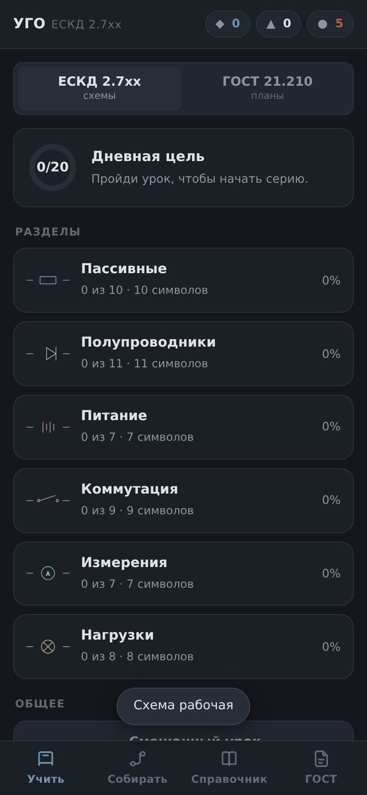
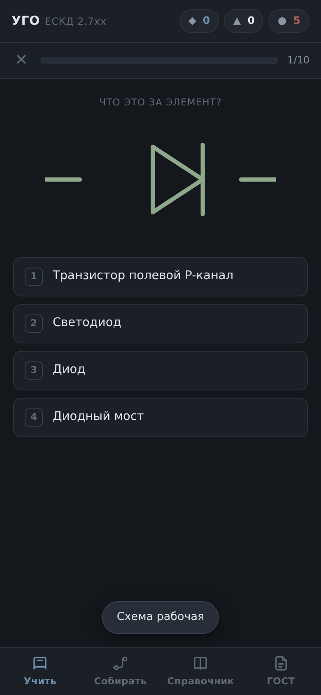
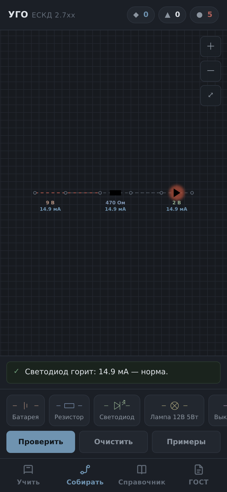
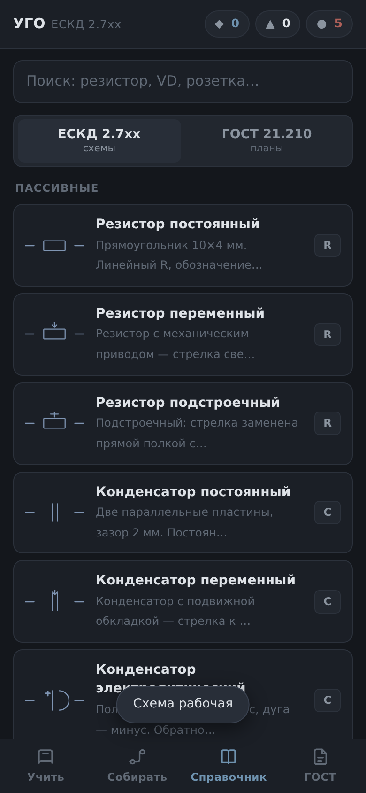
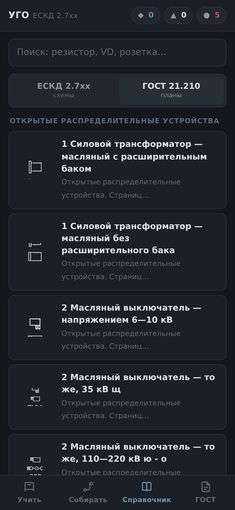
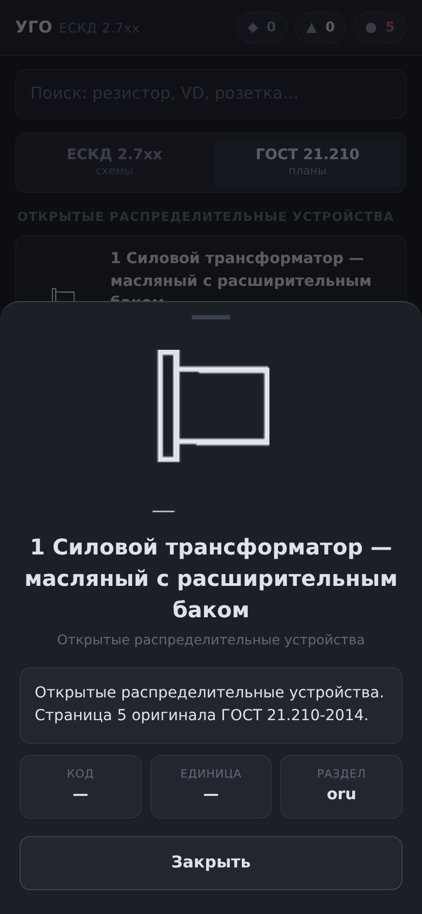
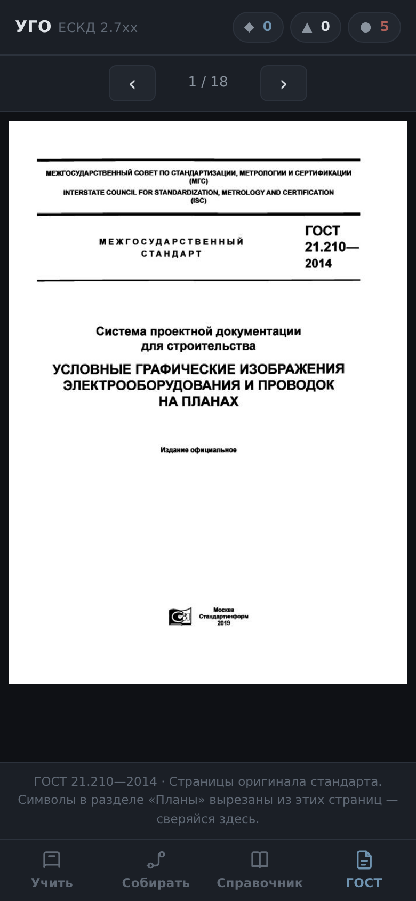

# УГО — тренажёр обозначений и сборка схем

Приложение для заучивания условных графических обозначений по двум стандартам
и для сборки электрических схем с расчётом токов. Всё работает офлайн, без сети
и без единого разрешения Android.

**201 symbol:** 52 векторных символа ЕСКД 2.7xx + 149 вырезок из ГОСТ 21.210—2014.

---

## Что внутри

### Учить
Интервальные повторения (SM-2) по шести разделам. Четыре типа вопроса:
символ → название, название → символ, описание → символ, буквенный код → символ.
Ошибочный символ возвращается в очередь в том же уроке. Есть цели на день,
серия дней, опыт и «жизни».

 

### Собирать
Редактор схем: перетаскивание компонентов, магнитные выводы, провода
кубическими кривыми Безье, зум щипком, бесконечная панорама. Решатель считает
режим методом узловых потенциалов (MNA) с линеаризацией диода по Шокли —
показывает токи, напряжения и диагностику: обрыв, короткое замыкание,
перевёрнутая батарея, неподключённые выводы.



### Справочник
Все символы с поиском по названию, описанию и буквенному коду. Переключатель
между ЕСКД и ГОСТ 21.210. Карточка символа — по тапу.

  

### ГОСТ
Все 18 страниц оригинала стандарта, чтобы любую вырезку можно было сверить
с источником.



---

## Откуда взялись символы планов

Символы не нарисованы заново — они вырезаны из отсканированного ГОСТ 21.210—2014
(таблицы 1–8, страницы 5–16). Пайплайн:

1. `pypdfium2` рендерит страницу в 4× (JBIG2-скан, `pypdf` здесь не годится).
2. Из текста страницы достаются координаты baselines; строки с номером пункта
   (`4.1`, `4.2.3`) становятся якорями.
3. Окно вырезки — фиксированной высоты: `y+30 … y−14` pt. Окно «до середины
   между соседними строками» оказалось хуже: у таблиц разная вёрстка, и глифы
   обрезались.
4. Со всей страницы бинаризацией и удалением линеек собирается маска, и вырезка
   берётся **из очищенной маски**, а не из сырого рендера — иначе в кадр
   попадают линии таблицы.
5. Обрезка по bbox, снятие рамки, ещё одна обрезка по bbox, перевод в
   белый-на-прозрачном RGBA. Отсеивается мусор с долей чернил < 1 % или > 80 %.

Результат: 149 символов, 0 отсеяно, 7 групп. Страницы 17–18 в подборку не вошли —
на них нет шапки таблицы, якоря не находятся.

---

## Сборка APK

```bash
export JAVA_HOME=/путь/к/jdk-17
export ANDROID_HOME=/путь/к/android-sdk
./gradlew assembleRelease
```

Подпись читается из переменной `UGO_KEYSTORE` либо из `keystore/ugo.keystore`
(в репозиторий не входит). Пароль и алиас — в `app/build.gradle`.

Готовые сборки — в [Releases](../../releases). Отпечаток сертификата
(SHA-256), чтобы убедиться, что APK подписан тем же ключом:

```
1f6c00c2affb66045812f80d30d0d6a55485567fff75170d95bd6e27650258ad
```

### Автосборка в GitHub Actions

`.github/workflows/apk.yml` собирает APK на каждый пуш и тег `v*`. Для
подписанного релиза положите ключ в секреты: `KEYSTORE_BASE64`, `KEYSTORE_PASS`,
`KEY_ALIAS`, `KEY_PASS`. Без них соберётся неподписанный release.

---

## Устройство

```
app/                 веб-оболочка — то, что показывает WebView
  index.html         4 вкладки
  styles.css         тёмная тема,Material 3
  symbols.js         52 символа ЕСКД, векторные (svgOf)
  plan-symbols.js    149 символов планов, сгенерировано из скана
  circuit.js         решатель MNA
  app.js             вкладки, уроки, редактор схем
  sw.js              офлайн-кеш (ugo-v2)
  plan/              149 PNG
  gost/              18 страниц оригинала
android/             оболочка: WebViewAssetLoader, minSdk 24, ни одного permission
tools/               вырезка символов из PDF и сборка данных
```

Приложение — веб внутри `WebView`. Ассеты раздаются через
`WebViewAssetLoader` с `file:///android_asset/`, сеть не нужна вовсе.

---

## Проверка

- решатель: 20/20 (`node tools/test-circuit.js` в каталоге `app`)
- интерфейс: 71/71, ноль ошибок в консоли (Playwright, 6 ширин экрана
  от 320 до 768 px, включая проверку переполнения и целостности всех 149 картинок)

---

## Лицензия

MIT. Символы взяты из ГОСТ 21.210—2014 и ГОСТ 2.7xx.
